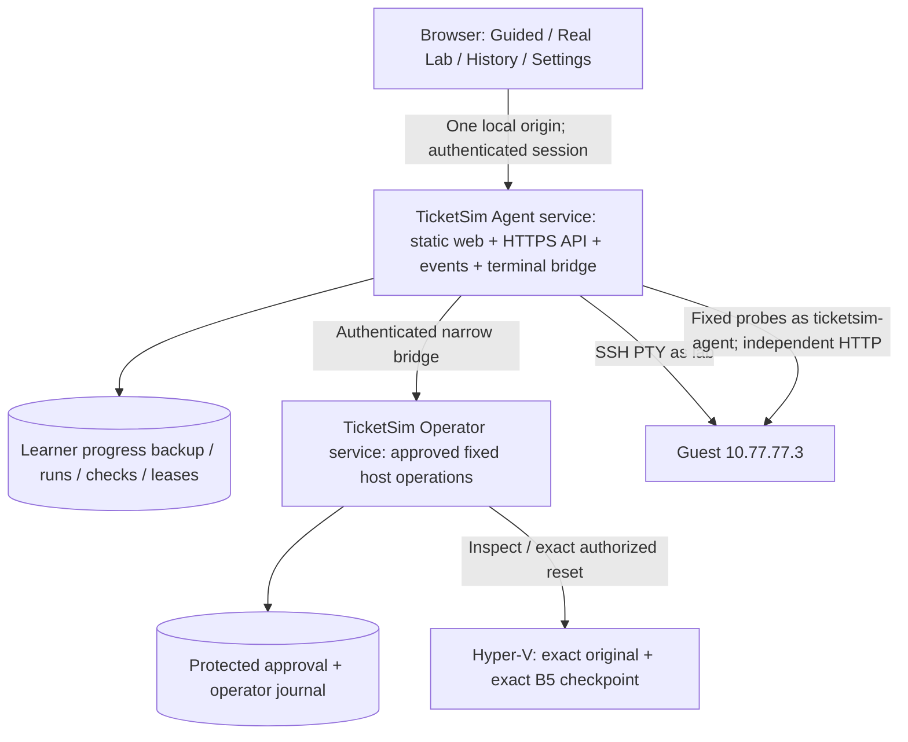

# TicketSim — phân tích hiện trạng và kế hoạch sản phẩm dùng hoàn toàn trên web

Ngày: 03/11/2026, Asia/Saigon. Baseline source: `acdb15bcaced568e926cc3a8f98e67bf565675c5`, branch `codex/b5-real-lab`.

Trạng thái tài liệu: kết quả phân tích và kế hoạch triển khai; các thành phần được ghi “đề xuất” chưa được xây dựng. Lượt này không bật Agent/Operator live, không inject fault, không reset hoặc thay đổi VM, checkpoint, switch, backup hay account Windows. Không sử dụng approval một lượt thử để thực hiện thay đổi hạ tầng trong lúc phân tích.

## 1. Kết luận sản phẩm và phạm vi phải hiểu thống nhất

TicketSim hiện có một ứng dụng học mô phỏng khá hoàn chỉnh và một đường Real Lab được bảo vệ bằng approval, nhưng chưa có trải nghiệm lab thật hoàn toàn trên web và chưa có bộ cài sản phẩm. B5 đã chứng minh baseline/checkpoint/recovery thực tế. B5 không chứng minh learner lifecycle end-to-end hoặc terminal web, vì terminal này chưa tồn tại.

Đích của bản phát hành tiếp theo:

> Cài TicketSim một lần trên máy Windows đang chứa lab; mở một shortcut/địa chỉ web cố định; learner chọn bài, đọc ticket, nhập lệnh Linux trong terminal web, kiểm tra website, ghi chú, nộp bài, xem điểm và theo dõi recovery. Không cần mở PowerShell, SSH client, npm hoặc console service trong một buổi học bình thường.

Quyết định phạm vi cho plan này:

- Giữ 112 ticket gốc, 112 Guided, 122 command cards và toàn bộ tiến độ cũ. Guided tiếp tục dùng fixture, kể cả khi Real Lab đã có terminal thật.
- Hoàn thiện đúng một live scenario `LAB-WEB-001` trên original đã được B5 qualification. Không biến 112 ticket thành 112 live lab.
- V1 chạy trong trình duyệt trên chính máy Windows chứa Hyper-V. Một learner/run trên một original VM tại một thời điểm.
- Cài đặt, đăng ký service, cấp quyền OS, certificate và account cách ly là công việc setup một lần, có giao diện cài đặt và UAC khi cần. Trình duyệt không thay thế quyền quản trị của Windows.
- Đưa điều khiển thường ngày và chẩn đoán sản phẩm lên web. Host không đủ điều kiện thì web hiển thị chính xác blocker; không yêu cầu learner tự chạy câu lệnh sửa hạ tầng.
- Bản dùng từ máy khác/LAN/Internet là mô hình triển khai riêng, không tự suy ra từ yêu cầu “trên web”. V1 không bind `0.0.0.0`, không mở public SSH/Hyper-V.

“Đóng gói gọn” nghĩa là một bộ cài, một shortcut, một origin web và hai service nền có trách nhiệm rõ. Không có nghĩa gộp web server với tiến trình quản trị Hyper-V hoặc nén cả backup/VM vào một file thực thi.

## 2. Phương pháp và độ tin cậy của kết luận

Đã đọc AGENTS.md, pickup guide trong living spec, README/ROADMAP, tài liệu B5 mới nhất, API/architecture/security/operator documents, source frontend/persistence/Guided và các đường Agent/Operator/PowerShell/guest dispatcher, cùng các test liên quan. Bốn audit untracked có sẵn chỉ được đọc tham khảo, không thêm vào Git, sửa hoặc xóa.

Đã đối chiếu evidence B5 và draft approval ngoài repo. Đã thực hiện đọc Hyper-V inventory/checkpoint và ACL thực tế; không gọi các action thay đổi VM. Kiểm tra browser dùng origin QA và storage context riêng, không dùng profile học của người dùng.

Phân biệt:

- **Đã đo/đã chạy:** regression ở mục 5; VM inventory, checkpoint inventory và ACL được đọc trong lượt này.
- **Bằng chứng bàn giao:** marker reset, SSH/HTTP/config/backup qualification của B5; không gọi đây là probe vừa chạy lại.
- **Suy luận từ source:** các lỗi session, refresh, auth, packaging, contract drift và thiếu terminal.
- **Chưa xác minh:** quyền sudo thực tế hiện tại của `lab`, SSH PTY qua web, installer/service identities, lifecycle live đầy đủ, backup hashes ở thời điểm triển khai mới.

## 3. Những phần đang có và cần giữ

| Phần | Hiện trạng | Đánh giá sử dụng lại |
|---|---|---|
| Nội dung gốc | 112 ticket, 14 topics; 104 CentOS Stream 9, 8 N/A | Giữ nguyên. Không áp nguyên lệnh CentOS vào Ubuntu live. |
| Guided | 112 case; 393 probes; 732 questions gồm 620 scored và 112 short-answer | Luồng học chính đã có; không viết lại engine. |
| Command Library | 122 cards, gồm 102 shell và 20 support tasks | Giữ và mở dạng drawer khi làm lab; gắn nhãn distro. |
| Advanced modes | 6 Stateful, 20 Objective, 20 review variants; Practice/Legacy vẫn giữ | Không cần mở lại để đạt web-first; bảo toàn dữ liệu và engine. |
| Progress | localStorage v5, migration v1–v4, JSON import/export | Giữ compatibility; xử lý origin migration khi cài bản mới. |
| React frontend | Vite/React/TypeScript; Guided, Library, History, Settings, Real Lab | Tái sử dụng UI và design system hiện có. |
| Agent | Loopback HTTP, pairing, run/event/lease SQLite, scenario registry | Tái sử dụng orchestration; cần productize auth/status/API. |
| Live lifecycle | Preflight → claim → fault → verify → learner → grade → reset → verify → release | Có nền tốt, chưa có live E2E qualification. |
| Guest automation | `ticketsim-agent`, forced-command dispatcher, exact sudo operations | Giữ cho automation, không đổi thành interactive learner shell. |
| Operator | Process riêng, token loopback, one-run claim, reserve reset trước khi thực hiện | Giữ ranh giới và nguyên tắc không retry reset mơ hồ. |
| Hyper-V/B5 | Một Standard checkpoint và cold backup đã qualification | Tái dùng đúng baseline, không tạo lại VM/checkpoint. |

Chất lượng nội dung và chất lượng phần mềm là hai trạng thái riêng: ledger/audit hiện ghi 71 command cards đã đối chiếu nguồn về cú pháp, 31 pending và 20 cần internal SOP; toàn bộ cards còn LAB_PENDING và chưa có independent SME sign-off cho 620 scored questions/122 cards/112 reference notes. Đóng gói và một Ubuntu lab thành công không được đổi các nhãn này thành “đã xác minh toàn bộ”. Hình desktop/mobile do browser suite vừa tạo đã được xem lại: layout Guided và design system hiện có có thể tái sử dụng; không cần redesign toàn ứng dụng để có terminal live.

Source of truth:

- Nội dung: `starter-data/`, `scripts/guided-content.mjs`, `scripts/content/`, `scripts/guided-reference-notes.mjs`.
- Guided runtime: `src/guided/`, `src/storage.ts`, `src/types.ts`.
- Live runtime: `agent/liveService.mjs`, `liveOperations.mjs`, `livePolicy.mjs`, `store.mjs`.
- Host operations: `operator/server.mjs`, `scripts/real-lab/Invoke-LabHost.ps1`, B5 modules.
- Generated data: `src/data/` và `public/`; không phải nơi authoring.

## 4. Hạ tầng thực tế và approval đang ở đâu

| Đối tượng | Identity và trạng thái đọc lại |
|---|---|
| Original | `ticketsim-lab`, `2b9c2170-9a23-4d08-b82e-29929afa4c10`, Running |
| Recovery | `463dddf4-6e47-47b7-a39f-5b5d7ef84df0`, Off |
| Protected | `lab1`, `546953dc-48e4-4080-839d-27ad5552ac7d`, Off |
| Checkpoint | Đúng một Standard: `e6d04330-142c-4397-8e0d-ddf5a9e69090`, `ticketsim-lab-b5-clean-baseline-v1` |
| Guest endpoint | `10.77.77.3/24`, service identity `ticketsim-agent`, learner identity `lab` |
| Host key | `SHA256:8LJ5bycBjgnfgRXp5tFh1jV/BGrfvb41rQQnzfbVi3U` |
| Cold backup | `C:\TicketSimBackups\baseline-2b9c2170-20261029`; bốn hash đã PASS trong evidence B5 |
| B5 lease | `E:\TicketSimOperatorState\b5\exclusive-lease` không tồn tại khi kiểm tra |
| Default current-user run DB | Chưa có `%LOCALAPPDATA%\TicketSim\real-lab\runs.sqlite` |
| Tài khoản riêng cho Agent | Chưa thấy account `TicketSimAgent` trong local-user inventory |
| Tài nguyên đọc trong lượt này | RAM trống khoảng 3.82 GiB; C khoảng 17.48 GiB; E khoảng 35.24 GiB |

Các tài nguyên này không được reserve. Lúc vận hành phải kiểm lại >=1 GiB RAM khi chạy, >=3 GiB ngay trước boot, C>=12 GiB, E>=15 GiB.

PM đã cho phép chuẩn bị và tiến hành **một** controlled trial, bao gồm recovery, với điều kiện cách ly principal và các prerequisite đạt. Draft ngoài repo vẫn `firstTrialApproved=false`, `resetApproved=false`; ID dự kiến `lab-web-001-first-trial-20261103-001`. Chưa có run, fault, grade hoặc recovery learner nào thực hiện. Sự chấp thuận có điều kiện không được dùng để vượt qua prerequisite thất bại hoặc khởi động lượt thứ hai.

Cold backup có trước guest-agent setup; fast checkpoint chứa guest agent. Installer không được coi hai artifact này có nội dung giống nhau, không sửa cold backup để tiện đóng gói.

## 5. Verification vừa thực hiện

| Check | Kết quả |
|---|---|
| `npm test -- --run` | PASS, 121 tests / 22 files |
| Prepare-data + content audit trong pretest | PASS, 112 tickets/Guided, 122 cards, zero errors; audit hiện báo 103 fixture changes |
| `npm run build` | PASS; main JS 1,063.20 kB, gzip 251.38 kB; có cảnh báo chunk >500 kB |
| `npm run test:browser` | PASS, 51/51, khoảng 1.2 phút |
| `npm audit --omit=dev` | 0 vulnerability được registry báo cho production dependencies tại thời điểm kiểm tra; không phải chứng nhận an toàn toàn bộ runtime |
| Node/npm thực tế | Node 25.1.0 / npm 11.6.2; runtime hiện cảnh báo experimental `node:sqlite` |
| Live learner E2E | NOT RUN |
| Web SSH terminal | NOT IMPLEMENTED |
| Windows installer/services/upgrade | NOT IMPLEMENTED |

Các unit live test dùng operation fakes; browser Real Lab test hiện chỉ kiểm tra unavailable landing page và không làm hỏng Guided progress. Không coi 121/51 tests là bằng chứng fault/grade/reset thật đã PASS.

## 6. Các khoảng trống cần giải quyết, theo mức ưu tiên

| ID | Mức | Bằng chứng/hiện trạng | Hệ quả và việc phải làm |
|---|---|---|---|
| F01 | P0 live | `SONNGUYEN\Admin` có Hyper-V Administrators enabled; `assertNonAdmin` chỉ kiểm tra elevation | Agent phải chạy principal thực sự không có quyền Hyper-V. Kiểm tra principal/token và effective access, không chỉ `IsInRole(Administrator)`. |
| F02 | P0 live | ACL của repo, `operator/server.mjs` và `Invoke-LabHost.ps1` cho Authenticated Users Modify | Không chạy Operator đặc quyền từ source tree này ở bản đóng gói. Cài code/runtime/module vào thư mục OS-protected; Agent không sửa được code/config do Operator nạp. |
| F03 | P0 product | Không có xterm/SSH PTY/WebSocket bridge; server hiện destroy mọi upgrade | Bổ sung terminal guest qua browser, auth và run binding; không mở host shell. |
| F04 | P0 product | Pairing code sống 5 phút, dùng một lần; bearer chỉ 15 phút, lab max 25 phút | Session có renewal, reauthentication và deadline hợp lý; không buộc restart service khi hết hạn. |
| F05 | P0 product | Token/note/run ở `RealLabPage` useState; component unmount khi đổi navigation | Refresh/rời trang có thể làm learner mất quyền quay lại và mất note chưa nộp. Session server + run rehydrate + draft note riêng. |
| F06 | P1 product | Vite, Agent 4174, Operator 4175 khởi chạy riêng bằng npm và env | Một installer/shortcut; static web cùng origin API; hai service nền và diagnostics. |
| F07 | P1 product | `/status` dùng sự tồn tại liveService làm `actionsEnabled`; `environmentReady`/`vmVerified` vẫn false | Phân biệt configured, host healthy, approved, fresh-preflight-ready, running, quarantined. UI không gộp thành “ready”. |
| F08 | P1 product | Start/Submit chờ toàn bộ workflow HTTP, UI chỉ busy; không SSE/polling | Operation async có ID, trạng thái bền vững và event stream; reload vẫn biết đang làm gì. |
| F09 | P1 reliability | UI sinh idempotency key mỗi request | Giữ key theo logical action, dùng lại khi mất response; backend dedup và unique lease vẫn là bảo vệ cuối. |
| F10 | P0 terminal | Chưa có terminal nên chưa có cơ chế cấm input khi submit/grade/reset | Phải revoke capability, freeze và đóng mọi channel trước grade; không để learner thay trạng thái trong lúc chấm. |
| F11 | P1 recovery | Operator actions chỉ ghi host action pass/fail; approval claim không có record hoàn tất toàn lifecycle | Host action thành công khác baseline verified. Thêm lifecycle-linked finalization, không xóa lịch sử claim hoặc reset counter. |
| F12 | P1 safety | `Inspect-Host` chưa trả protected VM state; không so sánh đủ protected before/after | Ghi identity/state/bindings cần thiết của protected/recovery; postchecks so sánh không đổi. Không suy từ đúng ID thành “không VM khác thay đổi”. |
| F13 | P1 contract | `src/real-lab/model.ts` là prototype, khác backend: cho retry restore và không có `completed` | Một public DTO/phase contract sinh/kiểm từ backend; UI không dùng prototype để cho phép operation. |
| F14 | P1 lifecycle | `history.length > 0` khóa Start trong UI mãi; policy thực lại bind approval ở Operator | Dùng server capability cho current approval. Bản đầu vẫn chặn lượt thứ hai; khả năng tương lai không phụ thuộc “history rỗng”. |
| F15 | P1 data | Progress Guided theo origin; đổi http/https, localhost/IP hoặc port sẽ tạo storage khác | Migration có export/import xác nhận, giữ dữ liệu cũ. Không nói dữ liệu mất hoặc tự truy cập được origin cũ. |
| F16 | P1 security | Default DB phụ thuộc account/profile; chuyển identity có thể tạo DB trống khác | Installer chọn một state root chuẩn, migrate có kiểm chứng; process singleton và lease authoritative ổn định. Không dựa vào quét tùy ý mọi user profile. |
| F17 | P1 auth | Guest automation key dùng `restrict,command=...`; không dành cho interactive shell | Learner dùng account `lab` với auth riêng; không bỏ forced-command/restrict hoặc dùng automation key làm learner key. |
| F18 | P1 learner UX | Catalog/title/objective có tên service/root cause, instruction yêu cầu SSH ngoài | Ticket trung tính, terminal tích hợp, thông tin Ubuntu rõ. Diagnostic metadata/operator action không xuất hiện như lời giải trong ticket. |
| F19 | P1 packaging | Không engines/runtime pin, service wrapper, launcher, upgrade/uninstall; README Node range rộng hơn nhu cầu SQLite | Bundle runtime đã qualification; không bắt learner cài Node/npm/pwsh bằng tay. |
| F20 | P2 performance | Main JS hơn 1 MB; App import sẵn cả mode ẩn | Lazy-load Real Lab/terminal/advanced modes, không gộp xterm vào first-load Guided. |
| F21 | P1 scope | 104 ticket CentOS, 8 N/A; chỉ một live Ubuntu manifest | Không tuyên bố toàn bộ 112 ticket chạy được bằng guest này. Provider/billing/panel cần adapter hoặc giữ simulated. |
| F22 | P1 evidence | README/ROADMAP/runbook cũ còn gate và số liệu lịch sử; audit fixture count hiện 103 | Đặt pickup/current-state rõ, link B5 và plan mới; bảo toàn tài liệu lịch sử nhưng không dùng nó làm trạng thái hiện tại. |

P0 là điều kiện phải giải quyết trước khi mở terminal/fault thật. Không có nghĩa dừng mọi công việc source/UI/package cho đến khi user tự tạo account.

## 7. Kiến trúc đích được đề xuất



Hai process/service, không cần thêm Docker/Kubernetes/Electron, public cloud, VM manager thứ hai hoặc framework backend lớn chỉ để phục vụ sản phẩm local này. React/Vite tiếp tục dùng để build; production không dùng Vite dev server.

| Phương án | Trải nghiệm web | Chi phí/giới hạn | Quyết định |
|---|---|---|---|
| Chỉ upload `dist` lên static hosting | Guided dùng được; browser không tự SSH/Hyper-V | Không cung cấp được real terminal/reset bằng frontend tĩnh | Không đủ cho mục tiêu Real Lab |
| App local, hai service nền, một browser origin | Đủ learner/operator workflow trên web của host hiện tại | Cần installer một lần và host có existing lab | Đề xuất V1 |
| Backend trung tâm, learner truy cập từ máy khác | Learner không cài runtime local | Cần HTTPS thật, user auth, network boundary, capacity/queue/ownership, backup/recovery trên server; một VM hiện chỉ phục vụ một run | Hướng sau V1 nếu cần truy cập LAN/Internet |
| Electron/desktop shell | Có thể nhúng web UI | Thêm runtime/window/update surface; không tự giải quyết service privileges hoặc recovery | Chưa có nhu cầu để chọn |

Web local không đòi VM mới cho mỗi buổi học: reuse original và exact checkpoint. Nếu chuyển sang server trung tâm, có thể vẫn dùng backend/terminal contract này nhưng phải bổ sung scheduler/capacity; không đưa host hiện RAM trống khoảng 3.82 GiB thành nền tảng nhiều learner bằng cách chỉ mở port.

### 7.1 Runtime và package layout

Layout đề xuất, chưa cài trong lượt này:

```text
Program Files/TicketSim/<version>/
  runtime/node/                 # version + checksum pinned
  runtime/powershell/           # absolute path, qualified Hyper-V compatibility
  web/                         # dist, immutable
  agent/ operator/ scripts/     # immutable production code and dependencies
  services/                    # wrappers and locked service config
  manifest.json                # versions, hashes, schema compatibility, licenses

ProgramData/TicketSim/
  agent/                       # Agent SID read/write; runs/checks/session data
  operator/                    # Operator SID write; approval/journal/private material
  shared/                      # narrowly ACLed bridge credential and public identity data
  tls/                         # private key readable only by the serving identity
  exports/                     # deliberate learner exports; no secrets
```

- Agent principal: standard dedicated Windows identity, không thuộc Administrators/Hyper-V Administrators, không có delegated VM management, không có write vào install/operator/backup/VM paths.
- Operator principal: separate identity với quyền Hyper-V cần thiết, không mặc định LocalSystem. Windows Hyper-V group vẫn là quyền rộng trên host; fixed API/scripts giới hạn đường dùng, không biến group này thành OS ACL chỉ cho một VM. Ghi rõ residual trust này.
- Installer kiểm tra quyền đọc/ghi thực tế từ từng identity, cả parent traversal và SQLite `-wal`/`-shm`, không cấp Modify cả `E:\TicketSimOperatorState` cho Agent.
- Existing B5 evidence/key có ACL chặt ở ngoài repo. Nếu cần bố trí lại file cho service, chỉ copy đúng artifact sau kiểm checksum/ACL; không chỉnh backup hoặc giả định account mới đọc được thư mục cũ.
- Service wrapper đề xuất WinSW, pin release/checksum/license sau packaging spike; phải set account rõ, không dựa default. Bundle Node LTS đã test `node:sqlite` API; không nâng runtime đang dùng chỉ dựa vào nhãn “LTS”. Node 25.1.0 là baseline QA hiện tại, không phải lựa chọn distribution mặc định.
- Launcher chỉ kiểm service và mở browser; không spawn Agent dưới `Admin`. Không cần console tồn tại sau khởi động.

Hai lớp phân phối phải ghi rõ: app installer chứa runtime/web/services; lab manifest của host hiện tại tham chiếu existing VM/checkpoint/backup. V1 chưa phải một lab image tự cài chạy trên mọi máy mới, vì target IDs/baseline đang pin vào host này. Muốn phân phối sang máy khác phải có VM-image/provisioning/qualification contract riêng; không lén thêm bước clone/import hoặc lấy checkpoint mới vào installer hiện tại.

### 7.2 Một origin và session

- Production origin đề xuất `https://127.0.0.1:4173`; server bind loopback. Installer quản lý certificate có IP SAN, trust và ACL chính xác, không yêu cầu learner bấm bỏ qua cảnh báo chứng chỉ. Đây là origin mới, phải có migration progress.
- Agent phục vụ static SPA, API `/api/v1/...`, SSE events và WebSocket terminal cùng origin. Browser không gọi trực tiếp Operator và không thấy bridge token.
- Session cookie HttpOnly/Secure/SameSite=Strict, host-only; CSRF token và exact Origin/Host checks cho mutations/upgrade. Không đặt bearer/SSH password trong URL, localStorage hoặc bundle.
- Bootstrap một lần qua installer/launcher có secret ngắn hạn; hết hạn có cách cấp lại có xác thực. Mã không bắt learner đi tìm trong PowerShell.
- Session có sliding idle timeout 15 phút, renewal khi có hoạt động được xác thực và absolute cap đề xuất 2 giờ. Deadline lab vẫn 25 phút trên server; renewal/reconnect không kéo dài deadline hoặc tạo run mới. Có reauth để xem/nộp run hiện tại khi session bị mất, không restart Agent.
- Operator approval do Operator xác minh, không cho Agent tự tạo approval bằng cookie learner. Installer bootstrap operator credential riêng qua giao diện cài đặt; verifier chỉ nằm trong protected Operator state. Sau setup, operator vào màn quản trị trên web để đăng nhập, xem exact target/action/effect/recovery và phê duyệt một run. Không phải mở console hoặc sửa JSON bằng tay.
- Operator service xác thực và cấp grant riêng có TTL ngắn, bind exact approval/run scope; Agent chỉ chuyển tiếp fixed requests. Machine bridge token hoặc learner session một mình không được mint admin approval. Mật khẩu/credential quản trị không dùng lại làm learner SSH password, không lưu trong Agent logs/state; mất credential xử lý qua installer repair với UAC. Việc UI ẩn nút không phải authorization.

### 7.3 Backend contract và operations

Giữ manifest/target/action allowlist phía server. Không có API nhận arbitrary VM/IP/checkpoint/script/PowerShell.

DTO mới có schema/version rõ; thống nhất `runId`, `phase`, `deadlineAt`, `gradeStatus`, `recoveryStatus`, `capabilities`, `blockers`, `eventSequence`. Mapper ở boundary tránh UI dùng raw SQLite row và prototype state machine cũ. Các check có observedAt, expected/observed dạng bounded/redacted và provenance phù hợp.

API dự kiến:

| Endpoint | Trách nhiệm |
|---|---|
| `GET /api/v1/environment` | Services/config/principal/preflight/approval/quarantine riêng biệt; không đọc backup hàng GB mỗi lần polling |
| `POST /api/v1/preflight` | Actual read-only check có thời điểm và kết quả; không inject hoặc consume approval |
| `GET /api/v1/session` | Resume current learner session/capabilities |
| `POST /api/v1/session/renew` | Renew có CSRF/session check; không tự kéo dài run |
| `POST /api/v1/learner-auth` | Xác thực fixed guest account trước Start; giữ SSH connection chưa mở shell, context bound owner/target, TTL đề xuất 120 giây; không lưu password |
| `POST /api/v1/operator/session` | Chuyển tiếp operator authentication đến privileged broker; không dùng learner cookie hoặc bridge token thay operator consent |
| `POST /api/v1/operator/approvals/:id/confirm` | Broker xác minh operator grant, fixed proposed permit và one-use ledger; không nhận arbitrary VM/script từ UI |
| `POST /api/v1/live-runs` | Validate approval; tạo durable start operation; 202 + operation/run reference |
| `GET /api/v1/live-runs/active` | Rehydrate run đang có; không suy từ run mới nhất bất kỳ |
| `GET /api/v1/live-runs/:id` | Authoritative run/check/result snapshot |
| `GET /api/v1/live-runs/:id/events` | SSE có sequence/cursor; reconnect từ event đã nhận |
| `PUT /api/v1/live-runs/:id/note` | Save bounded note draft, version/concurrency check |
| `POST /api/v1/live-runs/:id/terminal-session` | Fixed-target authentication, cấp terminal capability cho owner/run |
| `WS /api/v1/live-runs/:id/terminal` | PTY byte stream; exact run/owner/phase/origin checks |
| `POST /api/v1/live-runs/:id/submit` | Dedup logical action; freeze terminal; 202 + durable grade/recovery operation |
| `POST /api/v1/live-runs/:id/abandon` | Explicit learner intent; một approved recovery theo policy, không silent reset chỉ vì đóng tab |
| `GET /api/v1/live-runs/:id/report` | Bounded redacted evidence export, note và separate grade/recovery outcomes |

Implementation có thể dùng route hiện tại với versioned DTO để giảm thay đổi; đây là contract đích, không phải hứa tất cả URL đã tồn tại.

Durability:

- Thêm migration additive cho operations, check_results và note draft; giữ run/event/lease cũ. Backup DB trước migrate bằng SQLite-safe procedure; không copy file DB đang ghi mà bỏ WAL.
- Stable installation state path và singleton service; Operator có authoritative active-run binding/approval ledger. Đổi user hoặc đường dẫn DB không được làm hệ thống quên lease thật.
- Learner-auth context là opaque server reference, không chứa password phía browser; Start consume context một lần và dùng authenticated SSH connection để mở PTY chỉ sau `running`. Context hết hạn thì reauth trước inject; không cho pre-auth mở shell tự do vào baseline.
- Idempotency key gắn với logical Start/Submit, reuse khi mất response. UI nhận phase/job lại thay vì gửi action mới.
- Worker ghi intent/attempt trước mutation; sau crash không tự chạy lại fault/reset đang ambiguous. Restart tiếp tục read-only observation hoặc quarantine theo journal, không tự tạo thành công.
- Early preflight fail trước mutation có outcome riêng và safe lease release chỉ khi chứng minh chưa attempt mutation. Không reset VM sạch chỉ để “dọn” một preflight fail.

### 7.4 Terminal web thật

Đề xuất `@xterm/xterm` + fit addon ở frontend, `ssh2` và `ws` ở backend. Dependency exact versions/checksums/compatibility phải pin và test trong W3; tài liệu nguồn ở mục 13.

Đây là shell Linux trong guest, không phải ô PowerShell của host. Không sử dụng `node-pty` để mở Windows host shell. Không thay Guided classifier bằng SSH.

- Backend tự bind endpoint `10.77.77.3:22`, user `lab`, pinned host fingerprint. Browser không chọn tùy ý host/user/key.
- Dùng interactive SSH PTY, hỗ trợ stdin/stdout/stderr, resize, Ctrl+C, pager/editor, UTF-8 và copy/paste có kiểm soát. Không thay bằng chạy mỗi command qua `exec` rồi giả terminal.
- `ssh2` mặc định auto-accept host key nếu thiếu verifier; bắt buộc implement `hostVerifier` khớp fingerprint. Sai host key thì fail closed, không có nút accept-any.
- V1 learner nhập SSH password trực tiếp vào form web được phục vụ qua HTTPS, chuyển đến backend auth rồi bỏ reference ngay. Không xin password trong chat, không ghi logs/DB/localStorage. Backend không thể hứa zeroization tuyệt đối của JS memory; giảm thời gian tồn tại và không lưu bền.
- Sudo prompt diễn ra trong PTY thật. Không ghi raw keystrokes/transcript; tránh lưu cả output có thể chứa thông tin nhạy cảm. Ghi metadata kết nối, state/checks và learner note; export trích đoạn chỉ khi learner chủ động chọn.
- Guest automation giữ tài khoản/key khác; không nới `restrict` của `ticketsim-agent` để có PTY.
- Trước inject cần actual learner SSH authentication và read-only kiểm quyền `sudo -l`/khả năng được phép sửa Nginx theo cách operator xác minh. Việc xác minh quyền không được tự start/stop service. Chưa đủ quyền thì stop trước fault; không tự sửa guest/sudoers hoặc tạo checkpoint khác.
- Chuẩn bị/verify learner authentication trước fault; chỉ mở interactive channel khi run `running`. Nếu connection chưa sẵn sàng thì không để learner mất thời gian sau fault vì mới phát hiện password/account không dùng được.
- Một writable terminal owner cho một run. Tab thứ hai chỉ đọc/đề nghị takeover có xác thực; takeover revoke channel cũ. Không có hai writer vô tình.
- Mất WebSocket ngắn hạn: giữ cùng SSH channel trong grace period đề xuất 60 giây, bounded output buffer 1 MiB. Reattach cùng run nếu session hợp lệ; quá grace đóng SSH channel, run vẫn giữ deadline và cho reauth/new shell nếu còn `running`. Không hứa process terminal cũ sống sau SSH disconnect.
- Khi submit/abandon/timeout: CAS phase trước, revoke terminal capability, chặn mọi input frame, đóng channels/tickets rồi mới grade/reset. Chờ channel-close acknowledgement có deadline; không mở lại sau phase thay đổi. Nếu chưa đóng chắc chắn thì không ghi grade đáng tin cậy; quarantine/approved recovery theo boundary.
- Đóng SSH chưa chứng minh mọi process nền trong guest đã dừng. Với pilot single trusted learner, grade là observation tại thời điểm chấm, không phải hệ thống thi chống gian lận. Không cấp Mastered/chứng nhận từ điểm functional này; cần scoped guest privileges/isolated sessions nếu sau này muốn chống learner chủ động phá hoặc background races.
- Không expose SFTP, TCP forwarding, agent forwarding, X11 hay arbitrary subsystem. Việc không expose forwarding API không sandbox mọi lệnh Linux trong guest; quyền guest/network vẫn do guest và host isolation quyết định.
- WebSocket auth trước upgrade, exact Origin/Host, per-run capability, max frame đề xuất 64 KiB, bounded queues/backpressure, connection quota và rate limit. Các giới hạn là cấu hình sản phẩm phải test, không phải mặc định an toàn của thư viện.
- Terminal output là untrusted: không innerHTML, không eval, không auto-open link/title, không auto-write clipboard OSC52. Multi-line paste cần preview/consent. Không dùng demo attach server của xterm làm production backend.

### 7.5 Website verification ngay trong web

Learner có nút “Kiểm tra website” trong workspace. Backend chỉ gọi endpoint lab cố định; trả status, observedAt, exact-content match và plain-text preview bounded/escaped. Không render arbitrary guest HTML trong trusted application origin, không nhận URL tùy ý thành SSRF proxy.

Learner test không được đổi grade, setup state hoặc lease. Final independent grade vẫn là observation riêng ở backend, không tin text learner dán vào note.

## 8. Trải nghiệm sử dụng cần đạt

### 8.1 Lần cài đầu

1. Chạy bộ cài; wizard kiểm host requirements và hiện rõ Guided-only/Real Lab readiness.
2. UAC một lần để cài service/account/ACL/certificate/runtime. Không tự provision VM, tạo checkpoint hoặc sửa backup.
3. Nhận cấu hình existing lab qua file/operator selection đã kiểm identity; không gõ env bằng PowerShell. Secrets đi vào protected store, không vào web assets.
4. Operator xác nhận exact action/effect/recovery của one-run approval bằng flow quản trị, không dùng quyền learner.
5. Wizard mở web, hướng dẫn nhập progress export từ origin cũ nếu có.

Nếu thiếu Hyper-V/VM/backup/privileges: Guided vẫn dùng được khi có thể phục vụ web an toàn; Real Lab hiển thị blocker và nút diagnostics. Không nói “cài đặt thành công, sẵn sàng lab” khi mới copy xong file.

### 8.2 Mỗi buổi học

1. Bấm shortcut TicketSim → browser mở đúng origin.
2. Chọn Guided hoặc Real Lab. Guided luôn ghi rõ output mô phỏng; Real Lab ghi rõ guest thật và scope lab.
3. Real Lab đọc status/preflight; learner xác thực guest trong web nếu cần. Chỉ enable Start khi backend đủ điều kiện.
4. Bấm Start một lần; hiện progress chuẩn bị và fault verification, không lộ command inject hoặc lời giải.
5. Workspace có ticket, terminal thật, bộ đếm giờ, website test, ghi chú và tra cứu command theo Ubuntu. Desktop có thể chia hai cột; tablet/mobile dùng tabs.
6. Đi Library rồi quay lại hoặc refresh: cùng run/deadline/note, terminal reattach có trạng thái rõ. Không tạo fault thứ hai.
7. Nộp bài: khóa terminal, hiển thị đang chấm và kết quả từng check, sau đó recovery progress.
8. Hoàn tất: hiển thị **kết quả bài** và **kết quả khôi phục** riêng. Functional grade không được đổi thành PASS chỉ vì reset đã sửa website.
9. Một trial approval đã dùng thì Start tiếp bị khóa bởi server, có lý do. Lịch sử vẫn xem được, không cần xóa để cấp run mới về sau.

### 8.3 Màn hình và thành phần

| Màn hình | Thông tin cần có |
|---|---|
| Lab catalog | Scenario, Ubuntu version, thời lượng, available/blocked/running; không lấy mock title làm lời giải |
| Preflight panel | Trạng thái từng prerequisite, observedAt, next action dễ hiểu; chi tiết host ID trong operator view |
| Lab workspace | Ticket trung tính, web terminal, connection state, website check, note auto-save, deadline, submit/abandon |
| Result | Functional PASS/FAIL/UNKNOWN, từng check, note, recovery outcome, lease status, report export |
| Lab history | Run bất biến, status/grade/recovery tách riêng, mở lại result; không trộn điểm Guided |
| Settings/data | Guided export/import + Real Lab report export riêng; giải thích origin migration và retention |
| System diagnostics | Agent/Operator versions, safe principal summary, blocked reason, redacted export; không lộ key/token/path nhạy cảm cho learner |

Không đưa UUID/checkpoint/script names vào luồng học thông thường nếu learner không cần quyết định dựa vào chúng. Operator report vẫn giữ exact identities.

## 9. Recovery và safety contract sau khi có terminal

Giữ một lifecycle authority ở backend:

```text
readonly readiness + learner auth → acquire/claim → preflight recheck
→ inject once → independently verify fault → running
→ freeze/close terminal → grade actual state → record immutable grade
→ reserve reset once → shutdown original → apply exact checkpoint → boot
→ independently verify baseline → finalize operator lifecycle → release lease
```

- Recovery sau submit/timeout/failed fault verification chỉ theo permit đã bao gồm đúng nhánh đó; không diễn giải generic approval thành arbitrary VM administration.
- Approval one-use bind exact scenario/revision, VM, checkpoint, run, allowed mutation IDs; journal giữ consumed/attempted/finished và provenance của permit. Thêm expiry/revocation trước khi arm, không làm mất recovery authorization giữa run đang faulted.
- Operator reserve reset trước host call; timeout/disconnect giữ attempted/unknown. Chỉ retry read-only probes; không retry `Restore-VMSnapshot`, Stop/Start mơ hồ.
- Audit rõ host reset command complete khác independent baseline verified. Chỉ latter + lease invariants mới complete run.
- Recheck đúng một Standard checkpoint và disk parent chain, identities, all four backup hashes và resource thresholds ở các boundary cần thiết. Không băm backup 7 GB theo UI polling; full verification vẫn phải có trước những operation quan trọng. Đo thời gian thực để đặt timeout; không giảm hash verification để che timeout.
- Nếu learner làm VM Off hoặc phá SSH, reset endpoint hiện chỉ nhận target Running có thể từ chối. V1 không tự thêm forced shutdown/boot policy; giữ quarantine và exact blocker. “Recoverable” không có nghĩa được phép sửa mọi dạng phá hỏng ngoài scope.
- Không chạy protected VM/recovery VM; không đổi switch, NIC, unrelated disks hoặc backup.
- Crash trong injecting/restoring không tự restart operation. Có operator reconciliation có kiểm chứng, không sửa tay row/journal/lease để làm UI hết lỗi.
- Web operator diagnostics có thể trình evidence và thực hiện reconciliation qua fixed reviewed operation sau authenticated consent; không có nút clear lease/mark clean vô điều kiện. Nếu chưa đủ an toàn để tự động hóa exceptional recovery, màn hình báo rõ cần operator, vẫn bảo toàn journal.
- Upgrade/uninstall khi active/quarantined run phải bị chặn theo policy hoặc yêu cầu flow recovery được phép; không service-restart tùy tiện làm mất terminal và đổi state store.

## 10. Kế hoạch triển khai có thứ tự và đầu ra nghiệm thu

Ước lượng dưới đây là effort sơ bộ cho một người thực hiện có thể test Windows/guest, không phải lịch giao hàng đã cam kết. Tổng khoảng 15–25 ngày làm việc; availability operator, runtime/service packaging hoặc ACL có thể làm thay đổi. Không dùng thời gian ước lượng thay cho nghiệm thu.

### W0 — Chốt contract sản phẩm và inventory (0.5–1 ngày)

Đầu việc:

- Ghi current state/approval mới trong pickup guide; giải quyết tài liệu mâu thuẫn về B5.
- Scope AGENTS rõ terminal Guided fixture-only và Real Lab guest terminal riêng theo yêu cầu mới; không mở đường thực thi host từ Guided.
- Chốt canonical origin, local-single-learner, giữ legacy modes, acceptance ở mục 12.
- Chốt no-new-checkpoint/no-backup-modification và one-trial limit.

Đầu ra: contract ngắn, evidence inventory, acceptance checklist; không mở lại roadmap hạ tầng chung. Done khi đọc một entry point đã biết trạng thái hiện tại và đúng bước tiếp theo.

### W1 — Runtime có cách ly quyền và package skeleton (2–3 ngày)

Files chính: `agent/privilege.mjs`, `agent/server.mjs`, `operator/server.mjs`, scripts mới dưới `scripts/package/`, config schema mới dưới `runtime/`.

- Build production static server trong Agent, một origin.
- Prototype hai service identities, immutable code layout và state ACL; installer/launcher tối thiểu có thể đăng ký/chạy hai service mà learner không mở console.
- Runtime preflight chặn Administrator/Hyper-V group/delegated VM access trên Agent; probe từ chính token service. Không “test quyền” bằng thao tác thay đổi VM.
- Pin absolute executable/module paths, validate config/ACL và single installation state root.
- B5 proof/draft vẫn giữ nguyên ngoài repo; test service auth bằng read-only inspect khi prerequisites đạt.

Done khi Agent service không quản trị được Hyper-V, không sửa được Operator code/state/backup; Operator inspect hoạt động đúng principal; Guided được phục vụ từ package. Nếu identity chưa được cài trên host, vẫn hoàn thiện code/test/package; chỉ chặn actual live deployment, không đẩy thủ công toàn bộ setup sang learner.

### W2 — Session, DTO, operations và resume (2–3 ngày)

Files chính: `agent/auth.mjs`, `server.mjs`, `store.mjs`, `lifecycle.mjs`, public contract mới; frontend client/hooks mới.

- Cookie/session/CSRF/bootstrap/renew/reauth thay console pairing ở production; dev pairing có thể giữ riêng cho test. Operator login/consent trên web có broker-owned credential/grant, không authorize bằng learner token.
- Versioned DTO và capability/blocker model; không dùng old frontend prototype để authorize.
- Durable async Start/Submit jobs + operation IDs; SSE sequence reconnect.
- Stable idempotency theo logical action; server ownership + active-run endpoint.
- Additive DB migration, notes autosave và history read model. Không migrate Guided JSON sang schema lab.

Done khi refresh/rời tab/relogin khôi phục đúng run/note/deadline; mất HTTP response không repeat mutation; auth không hết hạn giữa lab 25 phút mà không có đường reauth; startup interrupted vẫn quarantine.

### W3 — Guest SSH terminal web (3–4 ngày)

Files mới đề xuất: `agent/terminalService.mjs`, `terminalTransport.mjs`, `terminalPolicy.mjs`, `src/real-lab/LabTerminal.tsx`, `useLabTerminal.ts`; update dependency lock và API tests.

- xterm rendering/fit/accessibility, SSH host verification, PTY và resize.
- Fixed `lab` target, password handling trong memory, pre-run auth readiness; forced-command automation không đổi.
- Authenticated WS upgrade, run capability, one writer, reconnect/grace, bounded buffers/backpressure.
- No forwarding/SFTP/host shell; sanitized lifecycle metadata, không transcript/keystroke logging.
- Terminal manager hook để revoke/freeze/close trước grade/reset.

Done khi terminal thật có editor/pager/Ctrl+C/UTF-8, host-key mismatch bị chặn, reconnect không inject, hết phase không nhận input. Test với SSH harness trước; read-only PTY/auth trên original chỉ khi identity/credential prerequisites đã đạt, không chạy fault chỉ để thử widget.

### W4 — Learner workspace hoàn toàn trên web (2–3 ngày)

Files chính: chia `RealLabPage.tsx` thành catalog/preflight/workspace/result/history; `src/App.tsx`, styles và navigation cần thiết.

- Không còn hướng dẫn learner mở external SSH hoặc nhập mã từ console.
- Ticket trung tính, terminal, fixed website test, note autosave, timer, command drawer có distro context.
- Progress chuẩn bị/chấm/reset riêng, mobile/keyboard/focus và connection state rõ.
- Kết quả grade/recovery tách riêng; UI phản ánh backend capabilities/current approval thay `history.length`.
- Lazy-load terminal/Real Lab/hidden modes; không đổi engine Guided.

Done khi learner hoàn thành workflow UI trong browser qua controlled integration harness mà không cần tool bên ngoài; workflow này chưa được gọi LIVE PASS trên VM thật.

### W5 — Hardening lifecycle/recovery cho terminal (2–3 ngày)

Files chính: `liveService.mjs`, `liveOperations.mjs`, `livePolicy.mjs`, `operator/server.mjs`, `Invoke-LabHost.ps1`, store migrations và relevant tests.

- Terminal closure barrier + CAS chống submit/timeout/input race; immutable grade trước recovery.
- Operator active-run/approval/action accounting và lifecycle finalization, separate host outcome/baseline outcome.
- Observe protected state và required postchecks; verify full backup + checkpoint type/chain tại boundary.
- Đo/reset timeout budget có stage evidence, no mutation retry khi ambiguous.
- Explicit abandon/timeout/restart/quarantine UX và reconciler chỉ bằng evidence.

Done khi failure matrix ở mục 11 PASS trên harness, old B5 safety regression vẫn PASS; không tạo checkpoint để test branches. V1 không mở rộng reset thành arbitrary VM repair.

### W6 — Bộ cài và quản lý dữ liệu hoàn chỉnh (2–4 ngày)

Files mới: installer/service/launcher configs, release manifest + license/SBOM, upgrade/uninstall scripts có guard và package smoke tests.

- Bundle tested Node/runtime, pwsh dependency, app artifacts và service wrapper; chạy offline sau khi cài.
- UAC/setup wizard tạo identities/ACL/certificate, kiểm thiếu prerequisites và giữ Guided usable.
- Migrate progress qua export/import origin cũ; không âm thầm xóa/ghi đè storage. Import preview/count và xác nhận trước thay thế, giữ export gốc.
- Một shortcut mở web; không console; diagnostics/export trên web.
- Upgrade versioned immutable files; DB/schema/version checks, rollback app chỉ khi compatible. Không tự downgrade database migration.
- Uninstall không xóa learner data, VM hoặc backup mặc định; remove chỉ certificate/services được chính installer quản lý.

Done khi standard learner dùng bản installed mà không cần Git checkout, npm, PATH tùy ý hay cửa sổ PowerShell; restart Windows vẫn mở đúng state, không lặp fault/reset. Fresh-machine app install được test với lab absent; host hiện tại dùng existing VM/B5 manifest, không auto-provision lại.

### W7 — Acceptance và đúng một actual live trial (1–2 ngày)

Phụ thuộc: W1–W6 và prerequisite/targeted terminal review đạt. Không consume trial trước khi đường web dùng được.

- Chạy unit/content/build/browser/security-package regression.
- Verify Agent effective identity/ACL; operator authentication; guest learner auth/quyền sửa Nginx; host resources; exact checkpoint; all backup hashes; no existing lease; actual read-only preflight.
- Gắn PM permit/operator consent vào unique one-run approval; không đổi draft true chỉ vì tests đã xanh.
- Learner mở installed web → Start một lần → độc lập xác minh fault/SSH → learner điều tra/sửa bằng web terminal → Submit → capture actual grade → đúng một checkpoint recovery → independent baseline verification → operator finalization/lease release.
- Không bắt learner làm sẵn lời giải hoặc dùng agent tự sửa Nginx thay learner. Chờ thao tác learner qua UI là một phần acceptance tương tác.
- Trường hợp fail/unknown: giữ evidence và quarantine, báo failed boundary; không khởi động lượt thứ hai bằng cách xóa DB, reset approval hoặc đổi journal.

Done khi report actual E2E đáp ứng mục 12. Nếu chưa có learner/operator tương tác thì ghi chính xác “package/automated acceptance đạt, actual trial chưa hoàn tất”.

Dependency path: `W0 → W1 → W2 → W3 → W4 → W5 → W6 → W7`. Có thể viết UI/transport tests trong lúc chuẩn bị installer, nhưng không mở fault trước các gate. Không yêu cầu thêm phase mock hoặc hạ tầng VM mới; harness chỉ phục vụ kiểm thử code cần thêm.

## 11. Test matrix bắt buộc cho phần thay đổi

| Nhóm | Trường hợp và kết quả cần chứng minh |
|---|---|
| Legacy regression | 112 IDs/content và progress v1–v5; unmatched Guided command không execute/fabricate; mode ẩn được giữ; old origin export không bị mất |
| Runtime/ACL | Agent standard identity; Hyper-V group/token/direct delegation bị phát hiện; Agent không sửa Operator install/config/journal/backup; standard user không thay executable được nạp privileged |
| Session | Bootstrap expiry, reauth, idle renewal, absolute cap, CSRF/cross-origin/DNS-rebinding Host rejection, cookie scope, refresh và nav resume, 15–25 phút |
| WebSocket | Reject missing/foreign origin/session/run/phase; replay capability; oversize frame; reconnect; two-tab writer takeover; input sau submit bị chặn |
| SSH | Wrong password/host key/user/target, auth timeout, UTF-8, sudo prompt, pager/editor/Ctrl+C, resize, lost channel, no forwarding or SFTP route |
| Secrets | Password/token không xuất hiện trong bundle, requests URL, app logs, SQLite/event/export hoặc saved terminal transcript; automated tests dùng fake marker secrets |
| Jobs/idempotency | Duplicate click/key, different keys same VM, mất response, submit-timeout race, worker/process interruption ở mỗi mutation boundary |
| Grade | Wrong HTTP content/200, Nginx active nhưng config sai, SSH mất, probe UNKNOWN; grade immutable trước reset; learner note không tự tạo PASS |
| Recovery | Reset failure/timeout/unknown, checkpoint mismatch/extra snapshot, disk-chain mismatch, recovery/protected changed, resource shortfall, backup hash mismatch, no auto retry, lease retained |
| Browser UX | Start→terminal→website→note→submit→result, mobile/desktop, keyboard, Library return, refresh, disconnected banner, no external terminal instruction |
| Installer | Offline launch, protected code/ACL, TLS trust, port collision, absent Hyper-V/lab, service restart, failed upgrade, DB/WAL safety, active-run upgrade guard, uninstall preserving data |
| Actual acceptance | Một fault, learner sửa trên web, actual grade, một recovery, exact independent baseline và release lease; tests/harness không thay thế |

Không chạy destructive negative scenarios trên original chỉ để tăng test coverage. Các failure branches chạy bằng isolated harness; actual original trial giữ đúng một fault/recovery được duyệt.

## 12. Definition of Done của sản phẩm web V1

Phải đạt toàn bộ các điểm sau:

1. Một bộ cài, một shortcut và một URL ổn định; không cần learner mở PowerShell, SSH client, npm hoặc console service.
2. Guided/Library/History/Settings và 112 ticket hoạt động; 112 IDs/progress cũ giữ nguyên sau migration được xác nhận.
3. Installed Agent và Operator chạy hai security principals đúng; code/config privileged immutable với Agent; có bằng chứng effective access.
4. Web terminal là SSH PTY trên đúng guest/account, host key được pin, không có host shell/arbitrary target.
5. Session/refresh/navigation/reconnect không làm mất run/note hoặc inject lại; timer server không reset theo browser.
6. Learner có thể kiểm website và nộp bằng chứng ngay trong web, không lộ lời giải trước khi làm bài.
7. Đóng terminal trước grade/recovery; actual functional grade độc lập với note và recovery.
8. Recovery chỉ đúng checkpoint đã qualification, không tạo/xóa/merge checkpoint; all baseline checks và operator finalization đạt trước release lease.
9. Unknown/failure giữ quarantine và evidence; không có reset retry hay clear lease tự động để làm màn hình xanh.
10. Hai outcome learner grade/recovery tách riêng, có redacted report thực tế.
11. Bản installed khởi động lại được/offline, upgrade/uninstall bảo toàn data và không gián đoạn active run tùy tiện.
12. Actual một live trial được ghi nhận đủ evidence. Không tuyên bố 112 live labs, SME sign-off, public multi-user platform hoặc LIVE PASS trước khi đạt.

## 13. Nguồn kỹ thuật chính thức đã đối chiếu

- [xterm.js security](https://xtermjs.org/docs/guides/security/): terminal output untrusted, context/XSS/origin protections, websocket authentication; không dùng production demo attach code. Phương án HTTPS/WSS và không render guest HTML cùng origin xuất phát từ các ranh giới này.
- [ssh2 README/API](https://github.com/mscdex/ssh2): interactive `shell`, PTY `setWindow`, password auth; thiếu `hostVerifier` sẽ auto-accept host key. Vì vậy explicit fingerprint verifier là acceptance bắt buộc.
- [ws client authentication](https://github.com/websockets/ws#client-authentication): authentication tại HTTP upgrade trước `handleUpgrade`; reject và destroy socket khi không hợp lệ.
- [Microsoft Service User Accounts](https://learn.microsoft.com/en-us/windows/win32/services/service-user-accounts): SCM chạy service với security context/access token của account cấu hình. Service identity phải kiểm thật, không suy từ cửa sổ console.
- [WinSW](https://github.com/winsw/winsw): service wrapper có bundled executable/config và install/start flow. Việc chọn wrapper/version là quyết định packaging cần qualification, không tự chứng minh ACL an toàn.
- [Node 24 SQLite API](https://nodejs.org/docs/latest-v24.x/api/sqlite.html): đối chiếu runtime target; SQLite API có lịch sử/stability riêng. Bundle exact tested runtime, giữ warning/stability note trung thực.

## 14. Những việc không nằm trong bản phát hành này

- Không chuyển 112 fixture cases thành live scenarios. Distro/provider/SOP/lab verification vẫn là backlog nội dung riêng; đóng gói không tự giải quyết nó.
- Không mở lại Stateful/Exam/Review navigation chỉ để có nhiều mode hơn.
- Không xây public cloud platform, multi-tenant scheduling, Kubernetes, billing hoặc remote VM fleet.
- Không cấp blanket Hyper-V API cho web, không biến command denylist thành sandbox, không tái sử dụng guest automation key làm interactive terminal.
- Không thay baseline bằng checkpoint mới cho thuận tiện. Nếu actual learner privilege cần guest change thì báo rõ đây là prerequisite chưa đạt và thiết kế operator change riêng; không tự invalidate B5.
- Không cho rằng “dùng hết trên web” loại bỏ nhu cầu installer/backend/OS permission. Nó loại bỏ thao tác kỹ thuật bên ngoài khỏi buổi học và gom vận hành chuẩn vào sản phẩm.

## 15. Điểm bắt đầu triển khai sau kế hoạch

Bắt đầu W0/W1 trong repo hiện tại, bảo toàn bốn audit untracked. Làm protected runtime/service skeleton cùng session/contract trước khi ghép terminal; sau đó W3/W4 tạo workflow web thực sự, W5/W6 hoàn tất recoverability và bộ cài, rồi mới dùng one-trial approval cho W7. Có thể tiếp tục implementation trong khi host identity setup chưa hoàn tất; actual fault vẫn bị chặn. Không yêu cầu learner tự ghép các cửa sổ PowerShell để bù cho phần sản phẩm chưa đóng gói.
